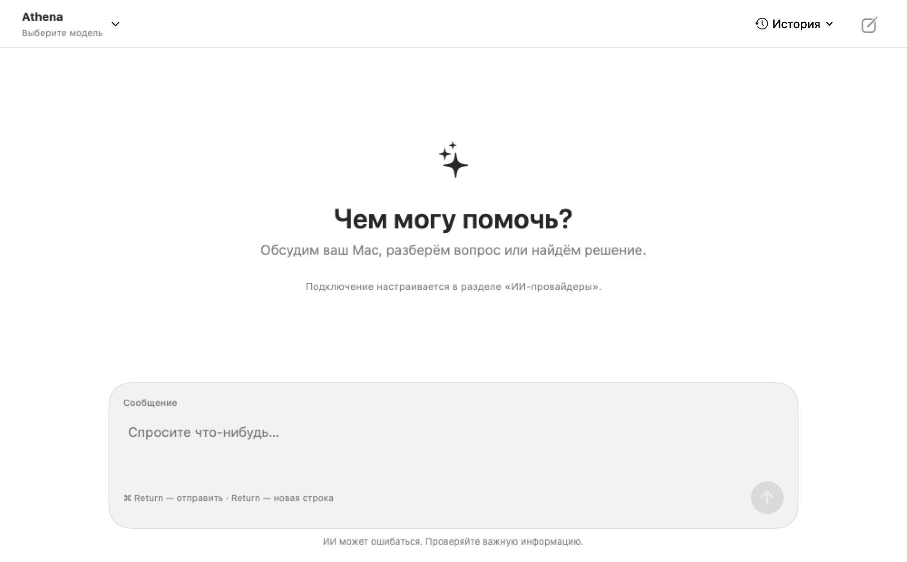
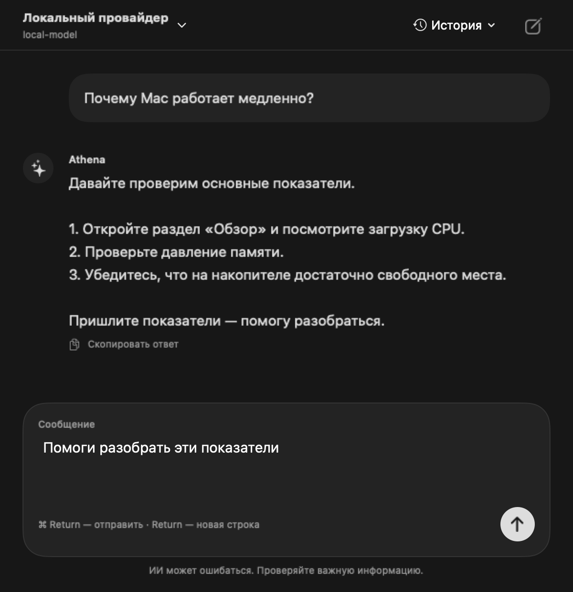

# Оформление ИИ-чата Athena — 0.1.3

Интерфейс вдохновлён компоновкой ChatGPT и сохраняет собственные название,
символы и нативные элементы macOS. Визуальная иерархия: выбор модели сверху,
приветствие либо переписка в центре, основное действие в редакторе внизу.

## Компоненты и токены

- `ChatStyle`: колонка 760 pt, боковой отступ 24 pt, интервалы 8/16/32 pt;
  системный шрифт 15 pt, заголовок 30 pt; радиусы редактора 24 pt и вопроса 20 pt.
- Цвет текста — системный primary/secondary, фон — textBackgroundColor;
  мягкая поверхность — primary с непрозрачностью 6%, разделитель — separatorColor.
- `ChatMessageRow`: вопрос справа, ответ с подписью и индикатором слева;
  текст можно выделять и копировать. Ответ модели не исполняется как HTML.
- `ChatComposerView`: многострочный TextEditor, явная метка, клавиатурный фокус,
  отправка по ⌘ Return; Return вставляет новую строку. Во время генерации
  кнопка отправки заменяется кнопкой остановки.
- `AIChatView`: история и новый диалог сверху; провайдер и модель в popover;
  отсутствие провайдера объясняется текстом; подключение выполняется только
  в отдельном разделе «ИИ-провайдеры». В чате доступны только выбор уже
  сохранённого профиля и идентификатор модели.

Цвета следуют теме macOS либо ручному выбору пользователя. Разметка проверена
в области чата 600×620 и 1000×620 pt, в светлой и тёмной темах. Это нативное
macOS-приложение: мобильные требования веб-чеклиста здесь неприменимы.

## Проверка дизайна

- Единая колонка у переписки и редактора; поле ввода не перекрывает сообщения.
- У каждого поля есть метка; у иконок действий — accessibilityLabel и help.
- История не меняется и новый запрос не отправляется во время генерации.
- При выборе провайдера подставляется его defaultModelID.
- Пустое сообщение, пробелы или пустая модель не разрешают отправку.
- Автопрокрутка продолжает ответ, когда пользователь находится внизу ленты.
- Визуально проверены светлая/тёмная темы и компактный/широкий макеты через
  NSHostingView. Снимки создаются только из тестовых данных, без сети.
- Полное управление VoiceOver, работа системных сочетаний в живом окне,
  increased contrast и измерение WCAG-контраста отдельно не проверялись.

